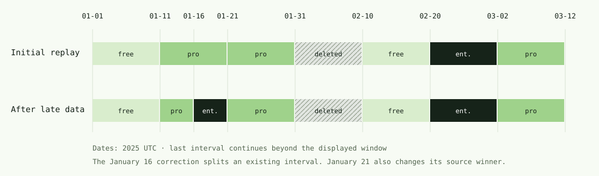

# Temporal CDC lab

**[View the report in your browser](https://Michaelhoang8.github.io/temporal-cdc-lab/)**

TypeScript ingestion into actual SQLite, with an immutable event inbox and SCD Type 2 style customer history. Late-arriving changes rebuild the affected entity's validity intervals inside the same transaction as inbox ingestion. The repository includes deterministic synthetic inputs, the resulting database, independent reconciliation, measured replay traces, a technical report, and review media.

**[Read the report](docs/report.html)** · [Screenshots](docs/screenshots/README.md) · [Review recording](docs/recordings/README.md) · [Inspect the SQLite database](results/store.sqlite)



## Recorded outcome

The committed replay consumed **915 arrival rows**: 800 unique accepted events, 100 identical duplicate attempts, and 15 quarantined candidates. It produced **640 intervals for 80 customers**, including 90 tombstone intervals. The current-state view contains 70 active customers; the other 10 end in deletion.

- Every interval matches an independent in-memory reference calculation.
- All 800 measured point-in-time checks match direct selection from canonical source events.
- Interval continuity, SQLite integrity, and foreign-key checks pass.
- Replaying all 915 arrivals accepts no new events, rebuilds no entities, and preserves all history. It reports 900 duplicate attempts and 15 quarantine attempts; the distinct quarantine row count remains 15.
- Nine fresh file-backed trials compare 10, 80, and 900 rows per transaction. The [raw timings](results/replay-timings.csv) and [report](docs/report.html#replay) show the measurements without a production throughput claim.

**Scope:** a local data engineering study, not a deployed CDC connector. Customers and dates are synthetic. Execution uses actual Node `node:sqlite`, transactions, indexes, SQL constraints, and a file-backed SQLite database. This is AI-assisted portfolio work; its measurements and screenshots are evidence of this reproducible lab, not evidence of production employment, historical manual work, or business impact.

## Reproduce

Use **Node 24** on Windows or Linux. The runtime has no npm dependencies: Node executes the erasable TypeScript directly and includes SQLite. Pinned development dependencies provide a separate strict TypeScript check across the engine, scripts and tests. No transpilation step, Python, database server, or API key is needed for the data pipeline. The recorded environment used Node 24.20.0 and SQLite 3.53.4; the [environment artifact](results/environment.json) records the actual runtime and normalized source hashes.

```sh
node --version
npm ci --ignore-scripts
npm run typecheck
npm test
npm run build:data
npm run replay -- --output results-local
npm run query -- results-local/store.sqlite customer-0001 2025-01-16T00:00:00.000Z
```

`results-local/` is ignored. The generator recreates deterministic `data/` files. Replay checks their manifest hashes, executes the primary mixed-input stream, verifies the independent oracle, repeats the stream to test idempotence, and runs all nine batch-size trials. It exits unsuccessfully if reconciliation fails. Use `--quick` for one repetition of each batch size. Use `--batch-size 80` to change the primary mixed-stream batch size; trial sizes remain 10, 80, and 900.

To deliberately replace the committed evidence and render a new report:

```sh
npm run replay
npm run report
```

The replay command replaces its own named output files, including `store.sqlite`, in the selected output directory. Use a dedicated lab output directory. Report generation reads existing `results/` evidence and does not rerun measurements. The CI workflow performs strict static checking, runs tests and executes a fresh quick replay on Ubuntu and Windows with Node 24; it uploads output artifacts and does not enforce timing thresholds.

## Event and validity contract

```json
{
  "eventId": "customer-0001-15-late",
  "entityId": "customer-0001",
  "effectiveAt": "2025-01-16T00:00:00.000Z",
  "sourceSequence": 8,
  "operation": "upsert",
  "attributes": { "plan": "enterprise", "region": "EU" }
}
```

| Field or rule | Meaning |
| --- | --- |
| `eventId` | Globally immutable ID. ASCII letters, digits, `_` and `-`, 1–64 characters. |
| `entityId` | Customer identity with the same ASCII restriction. |
| `effectiveAt` | Business validity instant, exactly four-digit-year UTC `YYYY-MM-DDTHH:mm:ss.sssZ`. Invalid dates and timezone alternatives are rejected. |
| `sourceSequence` | Nonnegative safe integer. Resolves candidates at the same effective instant; it does not override event chronology. |
| `operation` | `upsert` contains the complete customer state; `delete` requires null attributes. These are full images, not patches. |
| `attributes` | Exactly `plan` and `region`. Allowed plans: free, pro, enterprise. Regions: NA, EU, APAC. |
| Same effective instant | Largest source sequence wins; if tied, largest ASCII event ID wins. JavaScript direct string comparisons match SQLite `COLLATE BINARY` for permitted IDs. |
| Validity interval | `[valid_from, valid_to)`. The start applies; the end belongs to the next interval. Null end means the last accepted version. |
| Deletion | Explicit tombstone interval, with null attributes. Query consumers can distinguish deleted from not yet known. |
| Repeated unchanged state | Still starts an event version. Adjacent equal attribute values are not coalesced. |

`received_at` records actual ingestion wall time. `ingest_sequence` records accepted insert order. Neither determines business validity. Effective-time dates in this fixture are in 2025; replay timestamps reflect when the experiment ran. The model answers “what state was effective at this instant, given all accepted events now?” It does **not** answer “what did the warehouse know at an earlier ingestion instant?” That would require bitemporal history.

### Idempotence and quarantine

Validation happens before content canonicalization. Known fields are serialized in a fixed order, including nested attributes, so reordered JSON keys are equivalent. Duplicate detection compares exact canonical JSON; SHA-256 values are audit metadata.

An accepted event cannot be updated through ingestion. A different payload reusing its ID becomes `immutable_event_id_conflict` in quarantine, with candidate and accepted hashes. Invalid records are also quarantined. The table deduplicates a candidate by `(event_id, reason, candidate_sha256)`; counters report input attempts, not newly inserted quarantine rows. Quarantine and successful records from the same batch commit atomically.

**First accepted content wins.** If conflicting contents arrive in the opposite order, the accepted result can change. The fixture intentionally puts conflicting candidates after their accepted originals. Input-order invariance applies to nonconflicting events and identical repeats only; one test explicitly demonstrates the conflicting-order limitation. Legitimate corrections must use a **new event ID**, an intended effective time, and appropriate source sequence.

## Implementation decisions

1. **One transaction per batch.** `BEGIN IMMEDIATE` covers inbox inserts, quarantine inserts, affected-entity reads, history replacement, and commit. An injected exception after inbox writes or before commit rolls back all three tables. There is one synchronous writer; no claim of multi-writer orchestration or distributed exactly-once delivery is made.
2. **Rebuild each affected entity once per batch.** Accepted inbox rows are ordered by validity and tie priority. One winner is selected at each distinct time, then adjacent starts form interval ends. This handles arbitrarily late inserts and same-time corrections without a special merge path. It trades simple correctness for reads and rewrites proportional to that entity's accumulated history.
3. **Keep losing candidates and tombstones.** The inbox retains superseded same-time events. History retains deletion periods. This makes event selection and delete/recreate boundaries auditable.
4. **Keep quarantine separate from history.** A conflicting or invalid record cannot silently replace accepted content. The raw candidate remains available for review and a later deliberate correction using a new identity.
5. **Use explicit SQL constraints and reconciliation.** A partial unique index permits only one open interval per entity. Interval ends must exceed starts. Foreign keys retain source-event provenance. SQL checks adjacency; the independent reference checks completeness and winner correctness, which an overlap query alone cannot prove.

Source: [ingestion](src/cdc.ts), [independent reference](src/reference.ts), [schema and current-state view](sql/schema.sql), [inspection queries](sql/audit.sql), [interval reconciliation](sql/reconciliation.sql).

## Data and measured replay method

The generator creates 80 synthetic customer histories with 10 canonical events each. Seven events per entity are shuffled into an initial replay, including deletion and recreation. Three per entity arrive later: a backdated insert, a same-time higher-sequence revision, and an equal-sequence identity tie. The stream then includes 100 identical repeats, 12 conflicting candidates, and three invalid records. The LCG shuffle and seeds are fixed; no dataset download is required.

The primary replay uses 40-row batches and preserves the initial/late phase boundary, producing a before/after timeline for customer 0001. [Per-batch timing rows](results/batch-timings.csv) include phase, input offset, outcomes, affected entity count, and actual elapsed milliseconds. This is an inspectable ingestion trace; it is not a broker delivery trace.

Batch-size trials use 900 rows: the 800 canonical events plus 100 identical duplicates, with no conflicting or invalid candidates. Each repetition uses a fixed shuffled order shared across all sizes. The size execution order rotates across repetitions. Each trial starts with a fresh file-backed database using DELETE journal mode and synchronous FULL. Timing excludes schema initialization and the post-run reference check; it includes validation of already-loaded objects, canonical serialization, inbox writes, rebuilds, and commits. Input JSON loading is outside the timer.

Larger batches reduce both transaction count and repeated entity rebuilds. The measurements do not separate those costs. There are only three runs per size, no explicit warmup, no cache flushing, and no cold-cache or statistical-significance claim. These small local measurements do not predict a real warehouse, network connector, concurrent service, disk power-loss behavior, or production volume.

## Review the evidence

| Artifact | Purpose |
| --- | --- |
| [data/arrivals.jsonl](data/arrivals.jsonl) | All 915 inputs in the actual primary arrival order. |
| [data/canonical.jsonl](data/canonical.jsonl) | The 800 intended unique events, excluding malformed and conflicting candidates. |
| [data/manifest.json](data/manifest.json) | Counts, deterministic seed, fixture hashes, and time semantics. |
| [results/store.sqlite](results/store.sqlite) | Small inspectable database with inbox, history, quarantine, indexes and view. |
| [results/history.json](results/history.json) | Every materialized interval in canonical entity/time order. |
| [results/summary.json](results/summary.json) | Actual reconciliation counts, measurements, semantic hash and database hash. |
| [results/environment.json](results/environment.json) | Runtime versions, platform and LF-normalized experimental source hashes. |
| [results/timeline-example.json](results/timeline-example.json) | Before/after history for a late-corrected entity. |
| [results/asof-examples.json](results/asof-examples.json) | Real query results at exact validity boundaries. |
| [results/quarantine.json](results/quarantine.json) | Candidate identities, rejection reasons, and content hashes. |
| [results/replay-timings.csv](results/replay-timings.csv) | All nine batch-size trial measurements. |

The semantic history SHA-256 is computed from ordered JSON rows and remains stable for the accepted event set. The database file SHA-256 is specific to the recorded run: `received_at` timestamps, insertion metadata, and SQLite storage bytes can differ across reruns. Dataset and source hashes normalize CRLF to LF so Windows checkout conversion does not change their meaning. The environment file intentionally excludes hostnames, usernames and local paths.

## Tests

`npm test` runs 16 tests using Node's built-in runner over `tests/*.test.ts`. Cases exercise late splits, deletion/recreation and exact bounds, same-time ties, ASCII ordering, immutable-ID conflicts, duplicate key order, invalid schema/time/sequence values, transaction rollback at two fault points, no-op batches, file-backed reopen, and cross-order reconciliation. The permutation test runs six shuffle seeds against four chunk sizes on eight complete entity histories, comparing every interval plus direct as-of winners. Independent review cases cover expanded-year query rejection, refusing unsupported database versions without changing their schema, and ASCII tombstone ties under multiple arrival orders. A media test verifies the captured screenshots and recording against their manifest hashes.

Tests verify semantics rather than timing. Database reconciliation also runs during every fresh replay. Assertions fail the command instead of simply reporting a successful-looking metric.

## Runbook and schema evolution

1. **Unexpected history:** retain the input stream, inspect all inbox candidates for the entity in effective-time/sequence/ID order, then run [reconciliation.sql](sql/reconciliation.sql) and compare the reference. Do not use receipt time to “fix” effective-time ordering.
2. **Quarantined conflict:** compare candidate and accepted JSON in the database. Confirm the upstream immutable-ID contract. Keep the original accepted event; issue a corrected full-image event with a new ID if the business record needs changing. No automatic quarantine promotion is implemented.
3. **Invalid schema:** the version-1 validator rejects unknown fields and values. Decide an explicit migration and backfill strategy before admitting a new attribute. Old accepted event JSON is immutable; this lab has no live schema evolution or event upcaster.
4. **Failed batch:** an application exception rolls back the entire batch. Retry the same input after correcting the fault; duplicate protection applies to already committed work. This study does not inject process failure or assert power-loss guarantees.
5. **Unsupported database version:** `openStore` checks existing version metadata before executing schema DDL and closes on initialization error. Unknown versions and nonempty unversioned databases are refused. Use a separate database or implement a reviewed migration.
6. **Growing history:** measure hot-entity rebuild work and lock duration before scaling. Incremental interval repair, checkpoints, source offsets, event retention and bitemporal audits are unimplemented extensions, not hidden features.

The ingestion API accepts parsed JSON values from the fixed file contract. This study does not implement network payload limits, tenant authorization, secrets management, broker offsets, schema registry integration, deletion of retained audit data, or production operations. Its useful result is a reproducible, testable temporal ingestion core with explicit boundaries.
